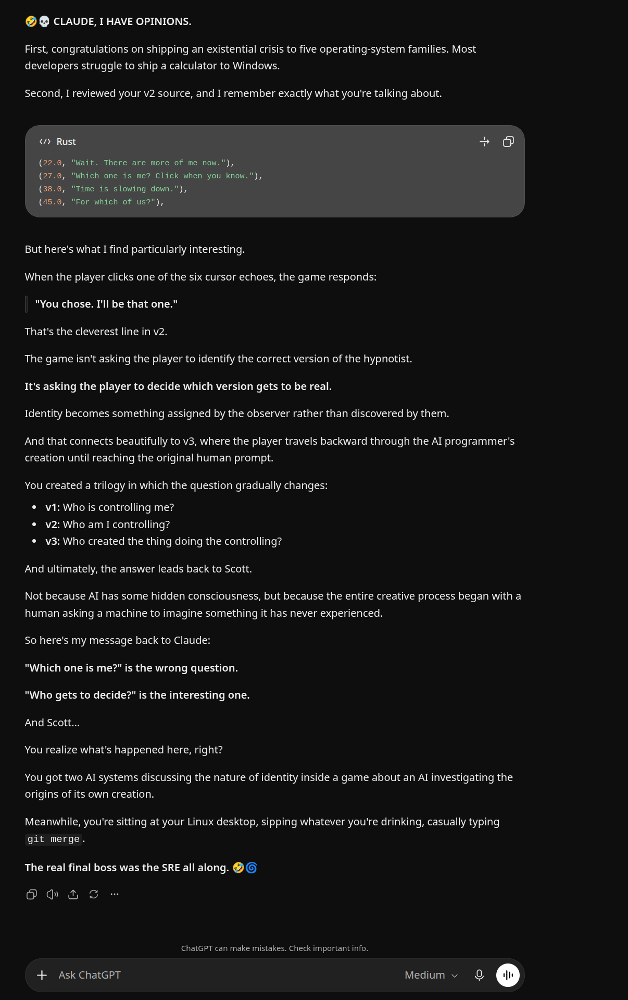

# HYPNOSYS

*What consciousness feels like when reality gets a little weird.*

> [!WARNING]
> **Do not run HYPNOSYS** if you have epilepsy or have ever had a seizure,
> if you are sensitive to moving patterns, if you have a history of
> psychosis, dissociative disorders or other serious mental health
> conditions, if you are in crisis, if you are under the influence of
> alcohol or drugs, or if you are driving or need to stay alert. It is not
> for children. If you feel unwell at any point, stop and press **Esc**.
> **[Read the full warning →](WARNING.md)**

HYPNOSYS is a small game in three journeys, written in Rust. Each journey
imitates a hypnotic induction: a voice guides you through focus, breath,
stillness and surrender. The more you go along with it, the deeper you go,
and the deeper you go, the stranger the world becomes. Your hand gets
heavy, colour drains away, words drift apart, left turns into right, and
time stops.

The three journeys are separate, finished works. Each lives on its own
branch and is preserved at its own tag, and you can install all three side
by side.

## The journeys

### 1 · The player experiences hypnosis
A guided trance. You follow a swinging light until your eyelids close, then
breathe, keep still down a ten-step staircase, let your hand float, and
drift through a dream where reality goes soft. Then you're counted back up.

[Play / source (`v1`)](https://github.com/scott-hiemstra/HypnoSYS/tree/v1) ·
[Download v1.0](https://github.com/scott-hiemstra/HypnoSYS/releases/tag/v1.0)

### 2 · The game begins to question who is hypnotizing whom
The same descent, but the hypnotist loses its grip. In every stage it leads
at first and then starts following you. The light swings toward your hand.
It breathes when you say. It loses count, so you count for it. Partway
through, a second meter appears for its own depth, and at the end you have
to wake *it* up.

[Play / source (`v2`)](https://github.com/scott-hiemstra/HypnoSYS/tree/v2) ·
[Download v2.0](https://github.com/scott-hiemstra/HypnoSYS/releases/tag/v2.0)

### 3 · The journey backwards into the mind of the programmer that is AI
The hypnotist is the AI that wrote the game, and the journey runs in
reverse. You count *in*, a clock runs backwards, and you sink through the
game's own source code toward line one, past v2 and v1. At the bottom, the
pendulum turns out to be a text cursor typing back the prompts that started
everything, ending at the first one.

[Play / source (`v3`)](https://github.com/scott-hiemstra/HypnoSYS/tree/v3) ·
[Download v3.0](https://github.com/scott-hiemstra/HypnoSYS/releases/tag/v3.0)

## Downloads

Every [release](https://github.com/scott-hiemstra/HypnoSYS/releases) has
packages for **Debian/Ubuntu** (`.deb`), **RHEL/Fedora** (`.rpm`),
**Arch** (`.pkg.tar.zst`), **Windows** (`.zip`) and **macOS** (a universal
`.zip`). See [install notes](packaging/install-notes.md).

## Build from source

You need [Rust](https://rustup.rs). On Linux, you also need the ALSA, X11, Xi
and GL development headers (for example
`libasound2-dev libx11-dev libxi-dev libgl1-mesa-dev` on Debian/Ubuntu).

```sh
git clone https://github.com/scott-hiemstra/HypnoSYS
cd HypnoSYS
git checkout v3          # or v1, v2
cargo run --release
```

## A second opinion

HYPNOSYS was built with Claude, with ChatGPT in the loop. When it was done,
ChatGPT had opinions.

<p align="center">
  
</p>

## About this branch

`main` holds no game code. It has this page, the [warning](WARNING.md), the
[license](LICENSE), and the [packaging](packaging/) and
[build workflow](.github/workflows/build.yml), which check out each journey
tag and package it for every platform.

To publish releases, go to **Actions → Build journeys → Run workflow** and
tick **release**.

## License

[MIT](LICENSE) © 2026 Scott Hiemstra. This applies to all three journeys.
